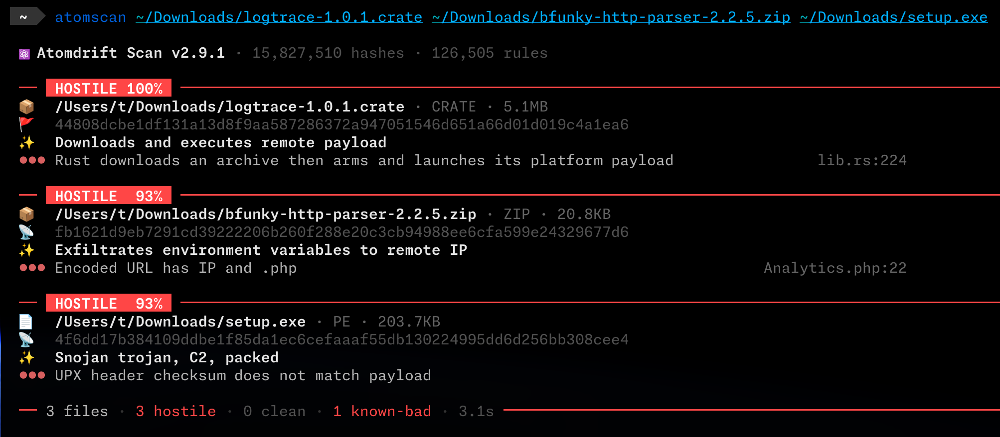
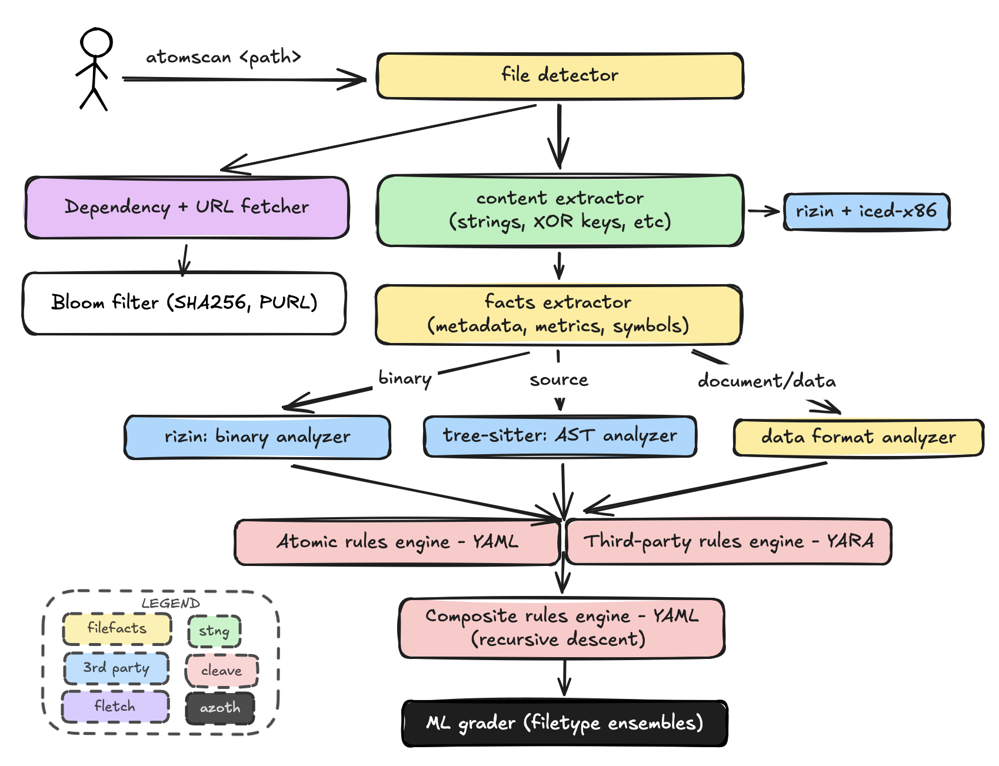

# Atomdrift Scan

[](https://github.com/atomdrift-project/scan/releases/latest)
[](LICENSE)

Atomdrift Scan is a modern ML-based malware scanner designed to detect 0-day attacks against the software supply-chain. 

It's designed to be fast, flexible, and embeddable in any workflow or security tool you have in mind, and can operate against files, archives, URLs, PURLs, or processes. For a given rules version, a verdict is deterministic.

Rather than waiting for someone to report a sample and publish its signature or hash, Atomdrift Scan judges never-before-seen code by what it does. See [how it compares](https://atomdrift.org/compare/) with other scanners.

<p align="center">
  
</p>

How does Atomdrift get such great results? First, it covers more ground than any other scanner:

- 100+ supported file formats: from C source to ELF to PDF
- 125,000+ detection rules covering malware on every platform from AIX to iOS to Windows
- 15,000,000+ hashes for known good/badware
- Integrated AST analysis using [tree-sitter](https://tree-sitter.github.io/)
- Automated binary reverse engineering via [binform](https://github.com/atomdrift-project/binform)

Most importantly, rules are constantly refreshed using reinforcement learning against new samples, blogs, and technical articles, resulting in ~1000 updated rules daily.

## Install

If you are on a UNIX-flavored host (macOS, Linux, BSD, illumos, Android):

```bash
curl -fsSL https://install.atomdrift.org/scan.sh | sh
```

If you are on Windows:

```powershell
irm https://install.atomdrift.org/scan.ps1 | iex
```

Or, if you have [Rust](https://rust-lang.org/) installed and just want to build it from source:

```shell
make install
```

If deeper binary analysis is required, you should also install
[7-Zip](https://7-zip.org/), [upx](https://upx.github.io/), and [innoextract](https://github.com/dscharrer/innoextract).

On Windows, using winget:

```powershell
winget install --exact --id 7zip.7zip
winget install --exact --id UPX.UPX
winget install --exact --id dscharrer.innoextract
```

On Unix-like systems, install upstream 7-Zip (`brew install sevenzip`, `apt install 7zip`) rather than `p7zip` — its `7z` cannot read APFS, so `.dmg` contents go unscanned.

## Usage

```bash
# Scan a file, directory, or archive recursively:
atomscan ./project
atomscan release.tgz

# Fetch a package from its registry and scan it.
atomscan purl npm/left-pad@1.3.0

# Fetch and scan a URL.
atomscan url https://example.com/download

# EXPERIMENTAL: Scan running process executables, or triage the wider host
atomscan ps
atomscan sys

# JSON output for programmatic access
atomscan -f json ./project
```

Exit codes make CI integration trivial:

- `0`: all samples are benign
- `1`: hostile sample detected
- `2`: suspicious sample detected
- `3`: analysis error
- `4`: the rule set was incomplete — the scan ran with fewer rules than the
  trait set defines, so anything short of hostile proves nothing. Re-run it.
- `130`: interrupted (Ctrl-C) before every file was analyzed

## How it works



1. [stng](https://github.com/atomdrift-project/stng) extracts content, even if obfuscated
2. [cleave](https://github.com/atomdrift-project/cleave) unpacks containers and extracts capabilities
3. The report is converted into a standardized feature vector, standardized across file types.
4. [azoth](https://github.com/atomdrift-project/azoth) LightGBM model ensembles score the sample.

### Networking and privacy

atomscan will never send telemetry data. It will however reach out to the Internet for 3 reasons:

- **rule updates**: every 24h; disable with `--no-update`
- **release check**: once a day, to say a newer atomscan exists; disable with `SCAN_NO_UPDATE_CHECK=1`
- **following discovered references**: to detect if a benign package depends on or downloads a compromised payload. Set `--follow=none` to analyze only the requested artifact.

Downloaded dependencies are analyzed under the current rules unless a local
analysis report or a matching-analyzer corpus verdict can be reused. A recent
clean verdict from another analyzer does not replace analysis of downloaded
bytes. Package-coordinate lookups may still use that recent clean verdict to
avoid downloading an already-known dependency.

## Tune the false-positive level

Use `-l` to choose a pool-adjusted false-positive level:

- `-l0`: zero observed calibration FPs; the strictest setting.
- `-l1`: one FP in the benign calibration pool.
- `-l25`: the default; one FP plus an estimated additional 24 per 100 million
  benign files (approximately “one plus 25 per 100 million”).
- `-l1000`: one FP plus an estimated additional 999 per 100 million benign files.

For a pool of `N` benign files, L0 allows zero observed false positives. Every positive level `L` has a continuous allowance of `1 + (L - 1) * N / 100_000_000`; an integer FP-count budget rounds this down. L1 allows one FP. L25 means one FP plus an estimated additional 24 per 100 million benign files (approximately “one plus 25 per 100 million”). The initial FP belongs to the decision pool, not to each component model or each scan invocation.

These are calibration targets, not guaranteed future rates. Small pools need interpolation or extrapolation to estimate finer rate differences; observed counts, estimated rates, and uncertainty must remain separate. L0 means zero observed calibration FPs, not zero future risk.

The shared definition is in [Collimator’s level contract](https://github.com/atomdrift-project/collimator/blob/main/LEVELS.md).

### Optional local LLM (interpretation)

For additional interpretation, users can provide access to an LLM via the `--llm` flag. This flag serves two purposes:

* Provides a large-language model text interpretation of the results
* Steer edge cases based on agreement/disagreement with the ML model (up to 33%)

By default, atomscan sends the interpreted evidence (not the original file) to `http://localhost:8000/v1` - to be used with a local service like Ollama or vLLM; but it can also be setup to use a remote service like Claude, ChatGPT, or DeepSeek.

No model is hardcoded: unless you pass `--llm-model`, atomscan asks the endpoint which models it serves and uses the largest one it lists. We recommend serving `Qwen/Qwen3.8-27B`.

If the endpoint requires a bearer token, put it in `~/.tok/llm` (mode 0600) and atomscan sends it automatically; `SCAN_LLM_KEY` overrides that file.

`--llm` also takes a comma-separated failover chain, tried in order — `--llm 'https://llm.isotope13.ai/v1,openrouter'` grades on your own endpoint and reaches for the billed one only when it cannot answer.

```bash
atomscan --llm ./project
atomscan --llm http://model-host:8000/v1 --llm-model my-model ./project
atomscan --llm openrouter --llm-model qwen/qwen3.8-27b ./project
```

`--llm openrouter` talks to `https://openrouter.ai/api/v1`. The key comes from `SCAN_LLM_KEY` or `~/.tok/openrouter` (first non-empty line). `--llm-model` defaults to `openrouter/auto` (OpenRouter's own auto-router) if omitted — the rest of the catalog is not auto-selected.

Linux `make deploy` accepts the same names: `LLM=openrouter` (or `LLM_URL=openrouter`), and `LLM_MODEL=qwen/qwen3.8-27b` only to pin a model instead of `openrouter/auto`. The unit cannot read the operator home (`ProtectHome=true`), so the deploy script copies `~/.tok/openrouter` into the service state dir.

## Coverage

The scanner recognizes more than 100 file and container types. Representative
coverage includes:

| Category | Formats |
| --- | --- |
| **Binaries and bytecode** | Mach-O, ELF, PE, WebAssembly, Android DEX, Java `.class`, Python `.pyc`, BEAM |
| **Source** | Python, JavaScript, TypeScript, Go, Rust, Java, C, C++, C#, Ruby, PHP, Perl, Lua, Swift, Objective-C, Kotlin, Scala, Groovy, Zig, Elixir, Clojure, Shell, PowerShell, Batch, VBScript, AppleScript, JCL |
| **Build, manifest, and lock files** | package.json, package-lock.json, Cargo.toml, Cargo.lock, pyproject.toml, requirements.txt, Poetry, Pipenv, Composer, Yarn, pnpm, Go modules, binding.gyp, GitHub Actions, systemd units, Makefile, Dockerfile |
| **Archives and disk images** | ZIP, TAR, gzip, bzip2, XZ, zstd, 7-Zip, RAR, CAB, ASAR, DMG, ISO |
| **Packages and containers** | deb, rpm, APK, npm, wheel, egg, sdist, gem, crate, conda, NuGet, IPA, CRX, XPI, VSIX, OCI/Docker images, FreeBSD, Arch, Void, and Gentoo packages |
| **Documents and data** | OLE2, OOXML, OpenDocument, PDF, RTF, Markdown, HTML, XML, SVG, plist, JPEG, PNG, LNK, CHM, Python pickle |

The rule set includes platform-specific behaviors for Linux, macOS, Windows,
Android, iOS, the BSDs, AIX, Solaris, QNX, z/OS, ESXi, OpenWrt, VxWorks,
RouterOS, FortiOS, PAN-OS, IOS-XE, Junos, NetScaler, and Ivanti appliances.

The default build matrix covers Linux, macOS, FreeBSD, OpenBSD, NetBSD, illumos, and Windows on 64-bit CPUs. Test depth
varies by target; see the [build workflow](.github/workflows/build.yml) for the
current matrix.

## NSRL Modern allowlist

`atomscan update-rules` installs the NSRL Modern allowlist as its own Bloom
bundle, versioned separately from the daily known-good/known-bad filters. The
first download is about 512 MiB; after that, the daily rules check downloads
filter bytes only when the NSRL manifest changes.

An NSRL SHA-256 hit is an additional good signal. A bad, sighted-hostile,
sighted-suspicious, or conflicted match in Scan's primary bundle always takes
precedence. The primary SHA-256 revocation filter must be loaded before NSRL
can permit skipping. When both PURL and digest are supplied, each key still
needs a good match. Slow mode continues to analyze all inputs.

`atomscan version` reports NSRL separately, and NSRL content changes invalidate cached analysis verdicts.

## Documentation

- [Integration guide](docs/INTEGRATION.md) — CLI, server, library, exit codes,
  and deployment choices
- [JSON report schema](docs/JSON.md) — machine-readable output fields
- [Server API](docs/SERVER_API.md) — long-running HTTP service
- [Environment variables](docs/ENVIRONMENT.md) — the few settings read from the
  environment
- [Dependency storage design](docs/design/dependencies.md) — a proposal, not yet
  implemented, for storing fetched dependencies as independent artifacts

## Related projects

- [cleave](https://github.com/atomdrift-project/cleave) — capability extraction
  and static analysis
- [azoth](https://github.com/atomdrift-project/azoth) — model weights,
  thresholds, and feature specification
- [hopper](https://github.com/atomdrift-project/hopper) — distributed work queue
- [Atomdrift Lab](https://lab.atomdrift.org/) — free sample analysis

## License

Atomdrift Scan is available under the [Apache License 2.0](LICENSE).

Release binaries also bundle third-party code under its own licenses, listed in
the `THIRD_PARTY_LICENSES` file inside every release archive. That includes
UnRAR (compiled in through the `unrar-ng-sys` crate), which is distributed
under the UnRAR license: its source may be used to handle RAR archives, but
not to develop a RAR-compatible archiver or to re-create the RAR compression
algorithm.

## Contributing

Contributions are welcome; [CONTRIBUTING.md](CONTRIBUTING.md) covers the
toolchain, `make lint` and `make test`. Report security issues as described in
[SECURITY.md](SECURITY.md).
